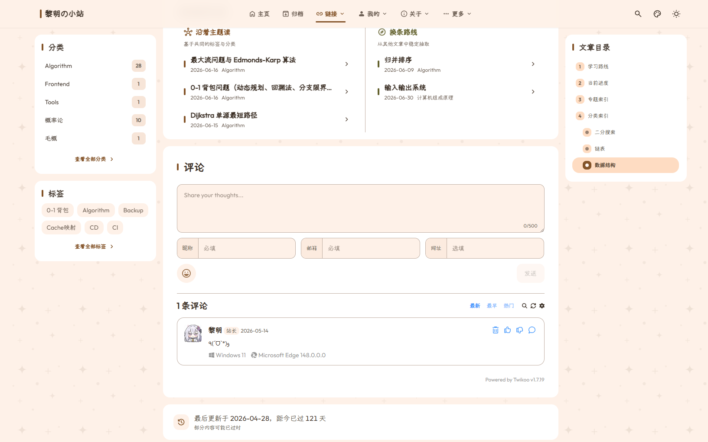

# Comment System Configuration

Shirone follows the **Zero Extra Burden Principle**: when the comment system is disabled (`enable: false` or omitted), the theme issues zero external network requests and loads 0 third-party client-side JavaScript, maintaining pristine performance.

This document covers integrating the comment system via `config/comment.yaml`. Three providers are supported:

- [Twikoo](https://twikoo.js.org/): requires a self-hosted or managed backend (Vercel, Railway, Tencent CloudBase, standalone VPS, etc.);
- [Giscus](https://giscus.app/): built on GitHub Discussions, **zero backend** — comments are stored in your own public repository;
- [Waline](https://waline.js.org/): requires a self-hosted or managed server (Vercel, Deta, Railway, standalone VPS, etc.), with anonymous comments, login, emoji, and article reactions.

Comment section rendering preview at the bottom of an article:


*Figure 1-1: Twikoo comment system interface at the bottom of an article*

---

## Integrating Twikoo

### Step 1: Obtain Twikoo Server Environment URL

Deploy your backend according to the [Twikoo Documentation](https://twikoo.js.org/) (supports Vercel, Railway, Tencent CloudBase, or standalone VPS), and obtain your environment URL or environment ID (e.g., `https://twikoo.example.com`).

### Step 2: Configure `config/comment.yaml`

```yaml
# 1. Master comment toggle
enable: true

# 2. Provider set to twikoo
provider: "twikoo"

# 3. Lazy loading toggle (recommended true: loads scripts only when scrolled into viewport)
lazy: true

# 4. Twikoo dedicated parameters
twikoo:
  # Environment ID or self-hosted backend domain from Step 1
  envId: "https://twikoo.example.com"

  # Frontend script CDN URL (defaults to official stable release)
  scriptUrl: "https://cdn.jsdelivr.net/npm/twikoo@1.7.20/dist/twikoo.min.js"

  # Interface language: "auto" (follows site language) | "zh-CN" | "zh-TW" | "en" | "ja"
  lang: "auto"

  # Comment textarea placeholder text
  placeholder: "Share your thoughts and feedback..."
```

---

## Integrating Giscus

Giscus stores comments in GitHub Discussions. No backend deployment is required, which suits bloggers already hosting their site on GitHub.

### Step 1: Prepare the Repository and the giscus App

1. Create a **public** GitHub repository and enable **Discussions** under Settings → General → Features;
2. Install the [giscus App](https://github.com/apps/giscus) and grant it access to that repository;
3. Open [giscus.app](https://giscus.app), pick the repository and a Discussion category (**Announcements** is recommended — only maintainers can open new discussions, preventing visitors from creating stray topics), and note down the generated `data-repo-id` and `data-category-id`.

### Step 2: Configure `config/comment.yaml`

```yaml
enable: true
provider: "giscus"

giscus:
  # Public repository in "owner/repo" format
  repo: "owner/repo"
  # Repository ID from Step 1
  repoId: "R_xxxxxxxxxx"
  # Category ID from Step 1
  categoryId: "DIC_xxxxxxxxxx"
```

`repo`, `repoId`, and `categoryId` are all **required**. If any of them is missing, the comment section is silently disabled — identical to a globally disabled system (no errors, zero extra burden).

### Optional Parameters

```yaml
giscus:
  # ...required fields as above...
  # Discussion category name (paired with categoryId)
  category: "Announcements"
  # Page-to-discussion mapping: pathname | url | title | og:title | specific | number
  mapping: "pathname"
  # Strict title matching (SHA-1 verification) to avoid fuzzy-search mismatches
  strict: false
  # Show reactions on the main post
  reactionsEnabled: true
  # Emit discussion metadata to the page (keep false in general)
  emitMetadata: false
  # Comment input position: "bottom" (default) | "top"
  inputPosition: "bottom"
  # Light/dark giscus themes (theme keys or custom theme CSS URLs),
  # synced to the comment iframe automatically when the site theme switches
  theme:
    light: "light"
    dark: "dark"
  # Comment language: "auto" follows the site language, or a giscus locale code (e.g. "zh-CN", "en")
  lang: "auto"
  # giscus client.js URL; replace when self-hosting giscus
  scriptUrl: "https://giscus.app/client.js"
```

---

## Integrating Waline

Waline's comment section follows the outlined style the theme uses for Twikoo, emoji in the comment box render as icons, and article reactions can appear above the comments.

### Step 1: Deploy a Waline Server

Deploy the server according to the [Waline Documentation](https://waline.js.org/guide/get-started/) (Vercel, Deta, Railway, or a standalone VPS), and note down the server URL (e.g., `https://comments.example.com`).

### Step 2: Configure `config/comment.yaml`

```yaml
enable: true
provider: "waline"

waline:
  # Server URL from Step 1; must be an http(s) URL
  serverURL: "https://comments.example.com"
```

`serverURL` is **required**. If it is empty or not an http(s) URL, the comment section is silently disabled — identical to a globally disabled system (no errors, zero extra burden). The client JS and CSS load only when the comment section enters the viewport; the defaults point at `@waline/client@3.16.1` on jsDelivr.

### Optional Parameters

```yaml
waline:
  # ...required field as above...
  # Client script and stylesheet URLs; keep both on the same version when self-hosting or upgrading
  scriptUrl: "https://cdn.jsdelivr.net/npm/@waline/client@3.16.1/dist/waline.umd.js"
  styleUrl: "https://cdn.jsdelivr.net/npm/@waline/client@3.16.1/dist/waline.css"
  # Language: "auto" follows the post/site language (unsupported languages fall back to "en"),
  # or a Waline language code (e.g. "zh-CN", "en", "jp")
  lang: "auto"
  # Text overrides; omitted keys keep Waline's defaults for the current language
  locale:
    placeholder: "Share your thoughts and feedback..."
  # Emoji: true uses Waline's default pack, false disables; a list of pack URLs also works
  emoji: true
  # Comment sorting: latest | oldest | hottest
  commentSorting: "latest"
  # Commenter info fields and which of them are required; an empty requiredMeta allows anonymous comments
  meta: ["nick", "mail", "link"]
  requiredMeta: []
  # Login mode: enable (login available, anonymous allowed) | disable (hide login) | force (login required)
  login: "enable"
  # Word limit, 0 for unlimited
  wordLimit: 0
  # Comments per page
  pageSize: 10
  # Image upload, code highlighting and TeX accept only true / false
  imageUploader: true
  highlighter: true
  texRenderer: false
  # Hide the footer copyright / RSS subscription links
  noCopyright: false
  noRss: true
  # Captcha site keys; leave empty to disable
  recaptchaV3Key: ""
  turnstileKey: ""
  # Article reactions: true shows them, false hides them; a list of custom image URLs also works
  reaction: true
```

> [!NOTE]
> Options reach the browser as JSON, so `imageUploader`, `highlighter` and `texRenderer` cannot take Waline's custom functions; a function fails the build. Page views are never collected (Waline's `pageview` stays off).

---

## Disabling Comments on Specific Posts

To disable comments for a specific post or announcement without affecting global settings, add `comment: false` in the post's frontmatter:

```yaml
---
title: "Maintenance Notice with Comments Disabled"
comment: false
---
```
